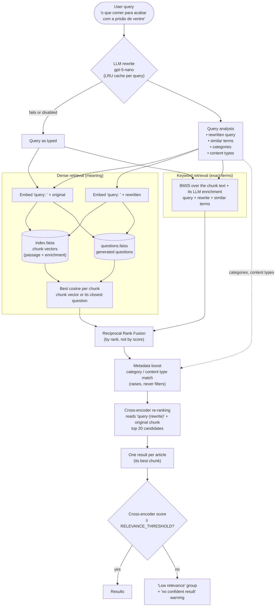
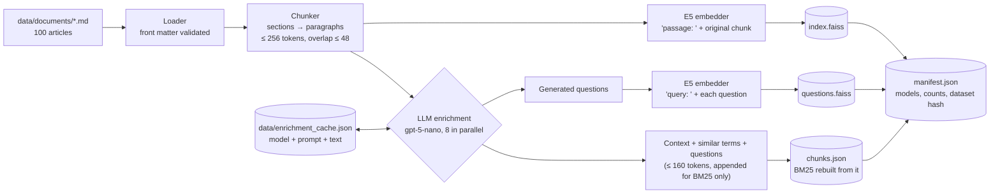

# Semantic Search

> 🇧🇷 Leia em português: [README.pt-BR.md](README.pt-BR.md)

Hybrid semantic search over **100 Portuguese health articles from Wikipedia**. A user
writes a question in their own words ("o que comer para acabar com a prisão de
ventre"), and the search finds the passages that answer it, even when the articles use
other words ("obstipação", "constipação intestinal").

It combines:

- **dense retrieval** (multilingual E5 embeddings + FAISS), which matches by meaning;
- **keyword retrieval** (BM25), which matches exact terms;
- **an LLM** (OpenAI `gpt-5-nano`, optional) that enriches every chunk at ingestion and
  interprets every query at search time, bringing the users' vocabulary into the index;
- **a cross-encoder** that re-reads the best candidates and flags weak results.

## Quick start

```bash
uv sync
cp .env.example .env                  # set OPENAI_API_KEY (optional, see below)
uv run python -m app.cli ingest       # build the index (enrich → embed → FAISS)
uv run python -m app.ui.dash_app      # web UI at http://127.0.0.1:8065
uv run python -m app.cli search "o que comer para acabar com a prisão de ventre"
```

Without `OPENAI_API_KEY` everything still works: the chunks are indexed as they are and
queries are searched as typed. With it, the ingestion costs well under US$ 0.50 for the
whole dataset (once; the answers are cached) and each new query a fraction of a cent.

### Docker

The image ships the prebuilt index from `storage/`, so run the ingestion before building it:

```bash
docker build -t semantic-search .
docker run --rm -p 8065:8065 --env-file .env semantic-search   # http://localhost:8065
```

The container runs on CPU with one gunicorn worker (each worker would load its own
copy of the models). The search process uses about **1.5 GB of RAM**, so it fits a
2 GB instance, with little headroom; 4 GB is comfortable. Both Hugging Face models
(~1 GB) are downloaded on the first start, which therefore takes a few minutes.

The `docker-compose.yml` at the repository root runs this same image together with the
other projects, behind a reverse proxy with HTTPS. It passes `OPENAI_API_KEY` from the root
`.env` (without it, queries are searched as typed) and keeps the models in the
`search-models` volume, so they are not downloaded again. See the
[root README](../../README.md).

## Web interface

The interface (`uv run python -m app.ui.dash_app`, at <http://127.0.0.1:8065>) is in
Portuguese and has two tabs.

**Busca (search)**

- Query box and example queries ("Experimente") to start with one click.
- **Search mode:** hybrid (default), semantic or keyword.
- **Category:** restricts the search to one of the five categories.
- **Number of results:** 1 to 20 articles.
- **Re-rank with the cross-encoder:** turns the re-ranking stage on or off.
- **Interpret the query with AI:** turns the LLM rewrite on or off. It is disabled, with a
  hint, when there is no `OPENAI_API_KEY`.
- **Compare the four methods side by side:** shows BM25, semantic, hybrid and hybrid with
  the cross-encoder in columns, for the same query.

Above the results the page shows the LLM's analysis of the query (rewritten query, similar
terms, categories, content types). Each result shows the article, its best chunk and a score
bar; "Detalhes da pontuação" (score details) lists the score and rank at each stage (FAISS
cosine, BM25, RRF fusion, cross-encoder), the generated question that matched and the
chunk's enrichment. Results below `RELEVANCE_THRESHOLD` go to a collapsed "low relevance"
group.

**Acervo (collection)**

Shows exactly what the search works with: four tiles (articles, chunks, categories and
enriched chunks) and a table of the 100 articles (id, title, category, tags, words, chunks,
Wikipedia revision and retrieval date), filterable by text and category. Clicking an article
shows its full front matter and every chunk as it was indexed, with its enrichment. When the
index was not enriched, a notice explains that the ingestion must run with the key.

## How a query is interpreted



Step by step:

1. **Interpret.** The LLM rewrites the query in the vocabulary of an encyclopedic
   article and extracts similar terms (technical and popular names), the categories
   that probably hold the answer and the kind of information wanted (symptoms,
   treatment, diet...). The answer is cached in memory, so the comparison view (four
   pipelines) and toggling a control do not call the LLM again. If the call fails, the
   search goes on with the query as typed.
2. **Retrieve by meaning.** Both the original and the rewritten query are embedded and
   searched in two FAISS indexes: the chunk vectors and the vectors of the questions
   generated for each chunk. Each chunk keeps its best cosine. A user question is much
   closer to a generated question ("O que comer para aliviar a prisão de ventre
   (constipação)?") than to an encyclopedic paragraph. Since each question is embedded
   alone, the LLM must name the subject in it: generic questions such as "Quais são os
   sintomas?" would get the same vector in many articles.
3. **Retrieve by terms.** BM25 searches the query, the rewrite and the similar terms
   over the chunk text **plus its enrichment**, so "prisão de ventre" matches a chunk
   whose article only says "obstipação".
4. **Fuse.** Reciprocal Rank Fusion combines both rankings by position, so the two
   incomparable score scales never need to be mixed. The BM25 ranking weighs 2, the
   dense one 1 (measured in [docs/EVALUATION.md](docs/EVALUATION.md)).
5. **Boost.** Candidates whose category or content type matches the query get a share
   of their remaining score headroom (`METADATA_BOOST`). It is a boost, not a filter:
   a wrong guess of the LLM must not hide the answer.
6. **Re-rank.** The cross-encoder reads the query (with its rewrite) together with the
   **original** passage of each candidate and scores its relevance in [0, 1]. It does not
   read the LLM block: with it, it ranked 3 fewer answers first (see Evaluation).
7. **Group and judge.** Each article appears once, with its best chunk. Results below
   `RELEVANCE_THRESHOLD` go to a collapsed "low relevance" group; when none passes, the
   page says that no confident result was found instead of presenting noise as an
   answer.

Example of a query analysis (illustrative; the real one depends on the model):

| Field | Value |
|---|---|
| Query | o que comer para acabar com a prisão de ventre |
| Rewritten query | alimentação no tratamento da constipação intestinal |
| Similar terms | obstipação, constipação intestinal, intestino preso, fibras alimentares |
| Categories | `nutrition` |
| Content types | `diet`, `treatment` |

The web UI shows this analysis above the results, and the score details of each
result show the generated question that matched and the chunk's enrichment.

## How the index is built



What the LLM writes for every chunk (stored in `chunks.json`):

| Field | Example | Used by |
|---|---|---|
| `context` | "Trecho sobre a alimentação no tratamento da obstipação." | BM25 |
| `similar_terms` | "prisão de ventre; intestino preso; constipação" | BM25 |
| `questions` (3–5, each naming its subject, since it is embedded alone) | "O que comer para aliviar a prisão de ventre (constipação)?" | **own vector** in `questions.faiss`, and BM25 |
| `content_types` | `diet`, `treatment` | metadata boost |

The enrichment is kept **apart from the passage** wherever that measured better: the
chunk vector and the cross-encoder use the original passage only (the cross-encoder
lost 3 queries in 1st place reading the LLM block; the vector was the same either way),
while BM25 indexes the passage plus the block, which is how it matches the users'
words. The text shown to the user is always the original passage. The enrichment is cached by
model, prompt version and chunk text, so re-running the ingestion only pays for new or
changed chunks. The ingestion is skipped when nothing changed (dataset, models,
chunking, enrichment); `ingest --force` rebuilds anyway.

## Design decisions

| Decision | Why |
|---|---|
| `intfloat/multilingual-e5-small` (384 dim) | Trained for query → passage retrieval, multilingual, fast on CPU. `multilingual-e5-base` was tested: ~10× slower per query, 1.9 GB of RAM, and it did not fix lay vocabulary. |
| LLM enrichment + query rewrite | The real problem is vocabulary ("prisão de ventre" vs. "obstipação"), which a bigger encoder does not solve. |
| Separate question index | Question-to-question similarity is far more reliable than question-to-paragraph. |
| `gpt-5-nano` with `reasoning_effort=minimal` | Cheapest OpenAI model per token; minimal effort keeps hidden reasoning tokens low. |
| Hybrid search + RRF | Dense finds paraphrases, BM25 finds exact names; RRF fuses ranks without calibrating scores. |
| Metadata as a boost, not a filter | A wrong classification must not remove the right answer. |
| Cross-encoder + relevance threshold | The only calibrated score; it says when nothing really answers. |
| Exact FAISS index (`IndexFlatIP`) | A few thousand vectors: exact search is instant and has perfect recall. |
| Category filter inside the search | `IDSelectorBatch` restricts FAISS (both indexes) and BM25 before ranking. |

Details of chunking, enrichment, embeddings and storage (in Portuguese): [docs/EMBEDDINGS_PIPELINE.md](docs/EMBEDDINGS_PIPELINE.md).

## Project structure

```
semantic_search/
├── app/
│   ├── cli.py                   # CLI: ingest, search, stats
│   ├── evaluation.py            # Metrics (hit@k, MRR) and the compared configurations
│   ├── core/                    # Settings, device (CPU/GPU), exceptions, logging
│   ├── ingestion/               # Loader (validated front matter) and chunker (sections → paragraphs)
│   ├── embeddings/              # E5 embedder ("query: " / "passage: " prefixes)
│   ├── vector_store/            # FAISS index (IndexFlatIP with id filtering)
│   ├── search/                  # Dense search, BM25 (with Portuguese stopwords) and RRF fusion
│   ├── reranking/               # Cross-encoder
│   ├── llm/                     # OpenAI client, chunk enrichment, query rewriting
│   ├── services/                # Indexing, search, index artifacts and wiring (factory)
│   └── ui/                      # Dash app: Busca tab (dash_app, components), Acervo tab (library)
├── data/
│   ├── documents/               # The 100 Markdown articles, with front matter
│   ├── eval/queries.json        # 60 evaluation queries with their expected articles
│   ├── enrichment_cache.json    # Enrichments already paid for (model + prompt + text)
│   └── README.md                # Sources, license and attribution of the dataset
├── storage/                     # Index built by `ingest` (FAISS, chunks.json, manifest.json)
├── scripts/
│   ├── fetch_dataset.py         # Downloads the articles again from Wikipedia
│   └── evaluate.py              # Runs the evaluation
├── docs/                        # EMBEDDINGS_PIPELINE.md and EVALUATION.md
├── tests/unit/                  # Tests with fake models and LLM (`slow` ones use the real models)
├── .env.example                 # The most used settings, commented
├── Dockerfile                   # Multi-stage image with uv, CPU only, non-root user, gunicorn
└── pyproject.toml               # Dependencies (CPU-only torch) and ruff/mypy/pytest config
```

## Dataset

100 health articles from the Portuguese Wikipedia (CC BY-SA 4.0), 20 per category:
nutrition, mental health, sleep and physical activity, chronic diseases, infectious
diseases and prevention. Sources, revisions and attribution:
[data/README.md](data/README.md). Download them again with
`uv run python scripts/fetch_dataset.py`.

**Why only 100 articles.** The collection was kept small on purpose because every
article costs AI processing at ingestion: one LLM call per chunk for the enrichment
(1,477 calls for these 100 articles) and, on CPU, the embedding of every chunk and of
every generated question (7,162 extra vectors), which takes tens of minutes on the test
machine. Both grow linearly with the collection, so thousands of articles would
multiply the API cost and the ingestion time. 100 articles are enough to show and
measure every technique; nothing in the pipeline limits the size.

Encyclopedic content used to demonstrate information retrieval; it is not medical
advice.

## Configuration

Every setting has a default in [app/core/config.py](app/core/config.py) and can be
overridden in `.env` (see [.env.example](.env.example)). The main ones:

| Variable | Default | Meaning |
|---|---|---|
| `OPENAI_API_KEY` | — | Enables the LLM steps |
| `ENRICHMENT_ENABLED` / `ENRICHMENT_MODEL` | `true` / `gpt-5-nano` | Chunk enrichment at ingestion |
| `QUERY_REWRITE_ENABLED` / `QUERY_REWRITE_MODEL` | `true` / `gpt-5-nano` | Query interpretation at search time |
| `LLM_REASONING_EFFORT` | `minimal` | Sent only to reasoning models |
| `METADATA_BOOST` | `0.15` | Boost for a category / content type match |
| `RELEVANCE_THRESHOLD` | `0.05` | Cross-encoder score below which a result is "low relevance"; calibrated so 96% of right answers show and off-topic questions are blocked |
| `CHUNK_MIN_TOKENS` | `40` | Sections smaller than this are joined to a neighbor section |
| `RERANK_CANDIDATES` | `20` | Candidates read by the cross-encoder (the slowest step on CPU); 20 matched 30 in quality at 40% less time |
| `EMBEDDING_MODEL_NAME` | `intfloat/multilingual-e5-small` | Changing it requires `ingest --force` |

## CLI

```bash
uv run python -m app.cli ingest [--force]
uv run python -m app.cli search "pressão alta" [--mode hybrid|semantic|keyword] \
    [--category nutrition] [--no-rerank] [--no-rewrite] [--compare]
uv run python -m app.cli stats
```

## Evaluation

60 questions written the way users write them ([data/eval/queries.json](data/eval/queries.json)),
each with its expected article(s).

With the LLM-enriched index (1,477 chunks, 7,162 generated questions), query rewrite off,
cross-encoder with 20 candidates:

| Chunk vector | Cross-encoder reads | hit@1 | hit@5 | MRR@10 |
|---|---|---|---|---|
| passage + LLM block | passage + LLM block | 0.73 | 0.92 | 0.806 |
| passage + LLM block | original passage | **0.78** | 0.92 | **0.849** |
| original passage | passage + LLM block | 0.72 | 0.92 | 0.799 |
| **original passage (default)** | **original passage (default)** | 0.77 | **0.93** | 0.847 |

Same setup, comparing where the 20 candidates come from:

| Candidates from | hit@1 | hit@5 | MRR@10 |
|---|---|---|---|
| Semantic | 0.72 | 0.92 | 0.798 |
| BM25 | 0.77 | 0.90 | 0.820 |
| Hybrid (RRF 1:1) | 0.77 | 0.93 | 0.847 |
| **Hybrid, BM25 weight 2 (default)** | **0.80** | **0.95** | **0.858** |

First results, before the enrichment existed:

| Configuration | hit@1 | hit@5 | MRR@10 | Mean latency |
|---|---|---|---|---|
| BM25 | 0.63 | 0.85 | 0.720 | 0.02 s |
| Semantic | 0.53 | 0.80 | 0.655 | 0.13 s |
| Hybrid (RRF 1:1) | 0.63 | 0.90 | 0.741 | 0.08 s |
| Hybrid + cross-encoder, 10 candidates | 0.72 | 0.90 | 0.793 | 5.9 s |
| **Hybrid + cross-encoder, 20 candidates (default)** | **0.77** | 0.92 | **0.840** | 10.3 s |
| Hybrid + cross-encoder, 30 candidates | 0.75 | 0.93 | 0.834 | 17.4 s |

Stemming in BM25 lowered hit@5 (0.90 → 0.83 in the hybrid search) and was removed. The
query rewrite and the metadata boost are not measured yet. Full results, decisions and
caveats (in Portuguese): [docs/EVALUATION.md](docs/EVALUATION.md).

```bash
uv run python scripts/evaluate.py                  # fast configurations
uv run python scripts/evaluate.py --list           # every configuration
uv run python scripts/evaluate.py --misses --configs hybrid,hybrid+rerank@20
```

## Tests and quality

```bash
uv run pytest                # fast tests: fake models and a fake LLM, no download, no API call
uv run pytest -m slow        # downloads and runs the real models
uv run ruff check . && uv run ruff format --check .
uv run mypy                  # strict
```

## Limits and next steps

- **Measure the remaining LLM steps.** The query rewrite, the multi-query and the
  metadata boost still need to be evaluated; any of them that does not improve the
  numbers should be turned off.
- **The evaluation set is small** (each question is 1.7 points of hit@5) and was written
  by someone who knows the collection; real user questions would make it more reliable.
- **The cross-encoder dominates the latency on CPU:** it reads the 20 candidates of every
  query and is the slowest step of the search.
- The LLM adds one call per new query (about a second); it is cached per query.
