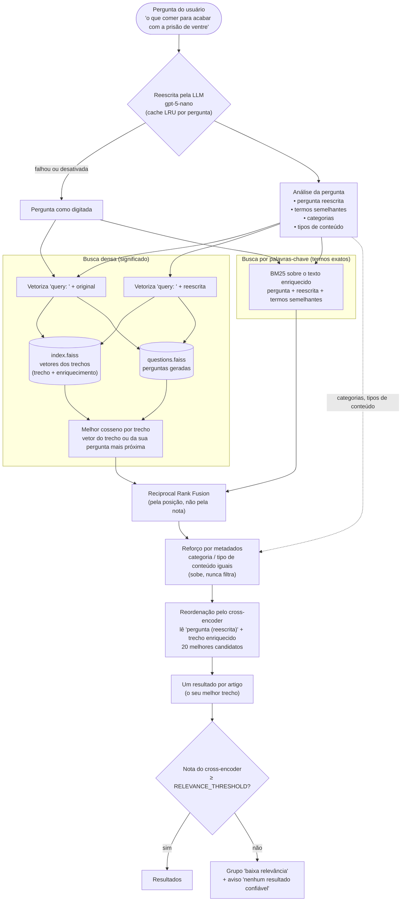
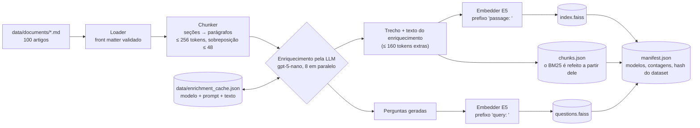

# Busca Semântica

> 🇺🇸 Read in English: [README.md](README.md)

Busca semântica híbrida sobre **100 artigos de saúde da Wikipédia em português**. A
pessoa escreve a pergunta com as próprias palavras ("o que comer para acabar com a
prisão de ventre"), e a busca encontra os trechos que a respondem, mesmo quando os
artigos usam outros termos ("obstipação", "constipação intestinal").

Ela combina:

- **busca densa** (embeddings E5 multilíngues + FAISS), que compara pelo significado;
- **busca por palavras-chave** (BM25), que compara termos exatos;
- **uma LLM** (OpenAI `gpt-5-nano`, opcional), que enriquece cada trecho na ingestão e
  interpreta cada pergunta na busca, trazendo o vocabulário do usuário para o índice;
- **um cross-encoder**, que relê os melhores candidatos e sinaliza resultados fracos.

## Início rápido

```bash
uv sync
cp .env.example .env                  # preencha OPENAI_API_KEY (opcional, veja abaixo)
uv run python -m app.cli ingest       # monta o índice (enriquece → vetoriza → FAISS)
uv run python -m app.ui.dash_app      # interface em http://127.0.0.1:8065
uv run python -m app.cli search "o que comer para acabar com a prisão de ventre"
```

Sem `OPENAI_API_KEY` tudo continua funcionando: os trechos são indexados como estão e
as perguntas são buscadas como foram digitadas. Com a chave, a ingestão do dataset
inteiro custa bem menos de US$ 0,50 (uma vez só; as respostas ficam em cache) e cada
pergunta nova, uma fração de centavo.

### Docker

A imagem leva o índice pronto da pasta `storage/`, então rode a ingestão antes de gerá-la:

```bash
docker build -t semantic-search .
docker run --rm -p 8065:8065 --env-file .env semantic-search   # http://localhost:8065
```

O container roda em CPU com um único worker do gunicorn (cada worker carregaria a sua
própria cópia dos modelos). O processo de busca usa cerca de **1,5 GB de RAM**: cabe
numa instância de 2 GB, com pouca folga; 4 GB é confortável. Os dois modelos do Hugging Face
(~1 GB) são baixados na primeira inicialização, que por isso demora alguns minutos.

O `docker-compose.yml` da raiz do repositório roda esta mesma imagem junto com os outros
projetos, atrás de um proxy reverso com HTTPS. Ele repassa a `OPENAI_API_KEY` do `.env` da raiz
(sem ela, as perguntas são buscadas como foram digitadas) e guarda os modelos no volume
`search-models`, para não baixá-los de novo. Veja o [README da raiz](../../README.md).

## Interface web

A interface (`uv run python -m app.ui.dash_app`, em <http://127.0.0.1:8065>) tem duas abas.

**Busca**

- Campo de pergunta e perguntas de exemplo ("Experimente") para começar com um clique.
- **Modo de busca:** Híbrida (padrão), Semântica ou Palavras-chave.
- **Categoria:** restringe a busca a uma das cinco categorias do acervo.
- **Quantidade de resultados:** de 1 a 20 artigos.
- **Reordenar com cross-encoder:** liga ou desliga a etapa de reordenação.
- **Interpretar a pergunta com IA:** liga ou desliga a reescrita pela LLM. Fica desativado,
  com uma dica, quando não há `OPENAI_API_KEY`.
- **Comparar os quatro métodos lado a lado:** mostra BM25, semântica, híbrida e híbrida com
  cross-encoder em colunas, para a mesma pergunta.

Acima dos resultados aparece a análise da pergunta feita pela LLM (pergunta reescrita, termos
semelhantes, categorias, tipos de conteúdo). Cada resultado mostra o artigo, o melhor trecho e
uma barra de pontuação; os "Detalhes da pontuação" trazem a nota e a posição em cada etapa
(cosseno no FAISS, BM25, fusão RRF, cross-encoder), a pergunta gerada que casou e o
enriquecimento do trecho. Resultados abaixo de `RELEVANCE_THRESHOLD` ficam num grupo recolhido
de "baixa relevância".

**Acervo**

Mostra exatamente o que a busca usa: quatro indicadores (artigos, trechos, categorias e trechos
enriquecidos) e uma tabela com os 100 artigos (ID, título, categoria, tags, palavras, trechos,
revisão da Wikipédia e data de obtenção), com filtro por texto e por categoria. Ao clicar num
artigo, aparecem o front matter completo e cada trecho como foi indexado, com seu enriquecimento.
Se o índice não foi enriquecido, um aviso explica que é preciso rodar a ingestão com a chave.

## Como a pergunta é interpretada



Passo a passo:

1. **Interpretar.** A LLM reescreve a pergunta com o vocabulário de um artigo
   enciclopédico e extrai os termos semelhantes (nomes técnicos e populares), as
   categorias que provavelmente têm a resposta e o tipo de informação pedida (sintomas,
   tratamento, alimentação...). A resposta fica em cache na memória, então o modo de
   comparação (quatro pipelines) e a troca de um controle não chamam a LLM de novo. Se
   a chamada falhar, a busca segue com a pergunta como foi digitada.
2. **Buscar pelo significado.** A pergunta original e a reescrita são vetorizadas e
   buscadas em dois índices FAISS: os vetores dos trechos e os vetores das perguntas
   geradas para cada trecho. Cada trecho fica com o seu melhor cosseno. A pergunta do
   usuário fica muito mais perto de uma pergunta gerada ("O que comer para aliviar a
   prisão de ventre (constipação)?") do que de um parágrafo enciclopédico. Como cada
   pergunta é vetorizada sozinha, a LLM é obrigada a citar o assunto nela: perguntas
   genéricas como "Quais são os sintomas?" dariam o mesmo vetor em vários artigos.
3. **Buscar pelos termos.** O BM25 busca a pergunta, a reescrita e os termos semelhantes
   no texto do trecho **mais o seu enriquecimento**. Assim, "prisão de ventre" encontra
   um trecho cujo artigo só diz "obstipação".
4. **Fundir.** O Reciprocal Rank Fusion combina as duas listas pela posição, então as
   duas escalas de nota, que não são comparáveis, nunca precisam ser misturadas.
5. **Reforçar.** Candidatos cuja categoria ou tipo de conteúdo combinam com a pergunta
   ganham uma parte da folga que falta para a nota máxima (`METADATA_BOOST`). É um
   reforço, não um filtro: um palpite errado da LLM não pode esconder a resposta.
6. **Reordenar.** O cross-encoder lê a pergunta (com a reescrita) junto com cada
   candidato enriquecido e dá uma nota de relevância entre 0 e 1.
7. **Agrupar e julgar.** Cada artigo aparece uma vez, com o seu melhor trecho. Os
   resultados abaixo de `RELEVANCE_THRESHOLD` vão para um grupo recolhido de "baixa
   relevância". Quando nenhum passa do limite, a página diz que não há resultado
   confiável, em vez de apresentar ruído como resposta.

Exemplo de análise de uma pergunta (ilustrativo; a real depende do modelo):

| Campo | Valor |
|---|---|
| Pergunta | o que comer para acabar com a prisão de ventre |
| Pergunta reescrita | alimentação no tratamento da constipação intestinal |
| Termos semelhantes | obstipação, constipação intestinal, intestino preso, fibras alimentares |
| Categorias | `nutrition` |
| Tipos de conteúdo | `diet`, `treatment` |

A interface mostra essa análise acima dos resultados. Os detalhes da pontuação de cada
resultado mostram a pergunta gerada que casou e o enriquecimento do trecho.

## Como o índice é montado



O que a LLM escreve para cada trecho (guardado em `chunks.json`):

| Campo | Exemplo | Usado por |
|---|---|---|
| `context` | "Trecho sobre a alimentação no tratamento da obstipação." | embedding, BM25, cross-encoder |
| `similar_terms` | "prisão de ventre; intestino preso; constipação" | embedding, BM25, cross-encoder |
| `questions` (3 a 5, cada uma citando o assunto, pois é vetorizada sozinha) | "O que comer para aliviar a prisão de ventre (constipação)?" | **vetor próprio** em `questions.faiss`, além dos anteriores |
| `content_types` | `diet`, `treatment` | reforço por metadados |

O texto mostrado ao usuário é sempre o trecho original. O enriquecimento fica em cache
por modelo, versão do prompt e texto do trecho, então rodar a ingestão de novo só paga
pelos trechos novos ou alterados. A ingestão é pulada quando nada mudou (dataset,
modelos, chunking, enriquecimento); `ingest --force` refaz mesmo assim.

## Decisões de projeto

| Decisão | Por quê |
|---|---|
| `intfloat/multilingual-e5-small` (384 dim.) | Treinado para busca pergunta → trecho, multilíngue e rápido em CPU. O `multilingual-e5-base` foi testado: ~10× mais lento por pergunta, 1,9 GB de RAM, e não resolveu o vocabulário popular. |
| Enriquecimento + reescrita pela LLM | O problema real é de vocabulário ("prisão de ventre" × "obstipação"), e um encoder maior não resolve isso. |
| Índice separado de perguntas | Comparar pergunta com pergunta é bem mais confiável que pergunta com parágrafo. |
| `gpt-5-nano` com `reasoning_effort=minimal` | O modelo mais barato da OpenAI por token; o esforço mínimo reduz os tokens de raciocínio. |
| Busca híbrida + RRF | A densa acha paráfrases, o BM25 acha nomes exatos; o RRF funde pela posição sem calibrar notas. |
| Metadados como reforço, não filtro | Uma classificação errada não pode remover a resposta certa. |
| Cross-encoder + limite de relevância | É a única nota calibrada; diz quando nada responde de fato. |
| Índice FAISS exato (`IndexFlatIP`) | Alguns milhares de vetores: a busca exata é instantânea e tem recall perfeito. |
| Filtro de categoria dentro da busca | O `IDSelectorBatch` restringe o FAISS (os dois índices) e o BM25 antes de ordenar. |

Detalhes de chunking, embeddings e armazenamento:
[docs/EMBEDDINGS_PIPELINE.md](docs/EMBEDDINGS_PIPELINE.md).

## Estrutura do projeto

```
semantic_search/
├── app/
│   ├── cli.py                   # CLI: ingest, search, stats
│   ├── evaluation.py            # Métricas (hit@k, MRR) e configurações comparadas
│   ├── core/                    # Settings, dispositivo (CPU/GPU), exceções, logging
│   ├── ingestion/               # Loader (front matter validado) e chunker (seções → parágrafos)
│   ├── embeddings/              # Embedder E5 (prefixos "query: " / "passage: ")
│   ├── vector_store/            # Índice FAISS (IndexFlatIP com filtro por IDs)
│   ├── search/                  # Busca densa, BM25 (com stopwords em português) e fusão RRF
│   ├── reranking/               # Cross-encoder
│   ├── llm/                     # Cliente OpenAI, enriquecimento dos trechos, reescrita da pergunta
│   ├── services/                # Indexação, busca, artefatos do índice e montagem (factory)
│   └── ui/                      # App Dash: aba Busca (dash_app, components), aba Acervo (library)
├── data/
│   ├── documents/               # Os 100 artigos em Markdown, com front matter
│   ├── eval/queries.json        # 60 perguntas de avaliação com os artigos esperados
│   ├── enrichment_cache.json    # Enriquecimentos já pagos (modelo + prompt + texto)
│   └── README.md                # Fontes, licença e atribuição do dataset
├── storage/                     # Índice gerado pelo `ingest` (FAISS, chunks.json, manifest.json)
├── scripts/
│   ├── fetch_dataset.py         # Baixa os artigos de novo da Wikipédia
│   └── evaluate.py              # Roda a avaliação
├── docs/                        # EMBEDDINGS_PIPELINE.md e EVALUATION.md
├── tests/unit/                  # Testes com modelos e LLM falsos (os marcados `slow` usam os reais)
├── .env.example                 # As configurações mais usadas, comentadas
├── Dockerfile                   # Imagem multi-stage com uv, CPU, usuário não-root, gunicorn
└── pyproject.toml               # Dependências (torch só CPU) e config de ruff/mypy/pytest
```

## Dataset

100 artigos de saúde da Wikipédia em português (CC BY-SA 4.0), 20 por categoria:
nutrição, saúde mental, sono e atividade física, doenças crônicas, doenças infecciosas
e prevenção. Fontes, revisões e atribuição: [data/README.md](data/README.md). Para
baixá-los de novo: `uv run python scripts/fetch_dataset.py`.

Conteúdo enciclopédico usado para demonstrar busca de informação; não é orientação
médica.

## Configuração

Toda configuração tem um padrão em [app/core/config.py](app/core/config.py) e pode ser
trocada no `.env` (veja o [.env.example](.env.example)). As principais:

| Variável | Padrão | Significado |
|---|---|---|
| `OPENAI_API_KEY` | — | Liga as etapas com LLM |
| `ENRICHMENT_ENABLED` / `ENRICHMENT_MODEL` | `true` / `gpt-5-nano` | Enriquecimento dos trechos na ingestão |
| `QUERY_REWRITE_ENABLED` / `QUERY_REWRITE_MODEL` | `true` / `gpt-5-nano` | Interpretação da pergunta na busca |
| `LLM_REASONING_EFFORT` | `minimal` | Enviado só a modelos de raciocínio |
| `METADATA_BOOST` | `0.15` | Reforço quando categoria / tipo de conteúdo combinam |
| `RELEVANCE_THRESHOLD` | `0.3` | Nota do cross-encoder abaixo da qual o resultado é "baixa relevância" |
| `RERANK_CANDIDATES` | `20` | Candidatos lidos pelo cross-encoder (a etapa mais lenta em CPU); 20 empatou com 30 em qualidade, com 40% menos tempo |
| `EMBEDDING_MODEL_NAME` | `intfloat/multilingual-e5-small` | Trocar exige `ingest --force` |

## CLI

```bash
uv run python -m app.cli ingest [--force]
uv run python -m app.cli search "pressão alta" [--mode hybrid|semantic|keyword] \
    [--category nutrition] [--no-rerank] [--no-rewrite] [--compare]
uv run python -m app.cli stats
```

## Avaliação

60 perguntas escritas como os usuários escrevem ([data/eval/queries.json](data/eval/queries.json)),
cada uma com o(s) artigo(s) esperado(s). Resultados no índice de 100 artigos, **sem** as
etapas com LLM (não havia chave na hora), numa CPU de 2012:

| Configuração | hit@1 | hit@5 | MRR@10 | Latência média |
|---|---|---|---|---|
| BM25 | 0,63 | 0,85 | 0,720 | 0,02 s |
| Semântica | 0,53 | 0,80 | 0,655 | 0,13 s |
| Híbrida (RRF 1:1) | 0,63 | 0,90 | 0,741 | 0,08 s |
| Híbrida + cross-encoder, 10 candidatos | 0,72 | 0,90 | 0,793 | 5,9 s |
| **Híbrida + cross-encoder, 20 candidatos (padrão)** | **0,77** | 0,92 | **0,840** | 10,3 s |
| Híbrida + cross-encoder, 30 candidatos | 0,75 | 0,93 | 0,834 | 17,4 s |

O stemming no BM25 baixou o hit@5 (0,90 → 0,83 na busca híbrida) e foi removido; pesos do
RRF diferentes de 1:1 não ajudaram. As etapas com LLM ainda não foram medidas.
Resultados completos, decisões e ressalvas: [docs/EVALUATION.md](docs/EVALUATION.md).

```bash
uv run python scripts/evaluate.py                  # configurações rápidas
uv run python scripts/evaluate.py --list           # todas as configurações
uv run python scripts/evaluate.py --misses --configs hybrid,hybrid+rerank@20
```

## Testes e qualidade

```bash
uv run pytest                # testes rápidos: modelos e LLM falsos, sem download nem chamada à API
uv run pytest -m slow        # baixa e roda os modelos reais
uv run ruff check . && uv run ruff format --check .
uv run mypy                  # modo estrito
```

## Limites e próximos passos

- **Medir as etapas com LLM.** Enriquecimento, índice de perguntas, reescrita,
  multi-query e reforço por metadados ainda precisam ser avaliados com a chave da API;
  o que não melhorar os números deve ser desligado.
- **O conjunto de avaliação é pequeno** (cada pergunta vale 1,7 ponto de hit@5) e foi
  escrito por quem conhece o acervo; perguntas reais de usuários o tornariam mais
  confiável.
- **O cross-encoder domina a latência em CPU** (cerca de 10 s por pergunta na máquina de
  teste com 20 candidatos; bem menos numa CPU atual).
- A LLM acrescenta uma chamada por pergunta nova (cerca de um segundo), com cache por
  pergunta.
