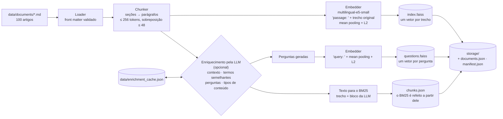
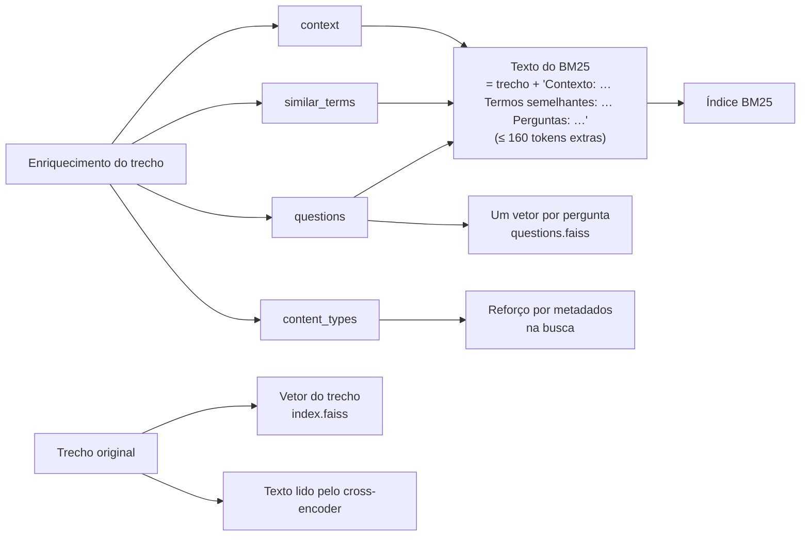

# Pipeline de embeddings: chunking, sobreposição, enriquecimento, embeddings e armazenamento vetorial

Este documento explica como os 100 artigos de saúde em português de `data/documents/`
viram vetores pesquisáveis: como são divididos em trechos (chunks), como trechos
vizinhos se sobrepõem, como uma LLM enriquece cada trecho com o vocabulário de quem
pesquisa, como cada trecho (e cada pergunta gerada) vira um embedding e como os vetores
ficam guardados no FAISS. A última seção mostra como a busca usa esse enriquecimento
para interpretar a pergunta do usuário.

Os números de chunking vêm de uma execução real sobre este dataset. Os de memória e
velocidade foram medidos numa CPU sem GPU (veja a [seção 5](#5-criando-os-embeddings)).



| Etapa | Código | Resultado neste dataset |
|---|---|---|
| Carregar | [`app/ingestion/loader.py`](../app/ingestion/loader.py) | 100 documentos validados |
| Dividir | [`app/ingestion/chunker.py`](../app/ingestion/chunker.py) | 1.477 trechos |
| Enriquecer | [`app/llm/enrichment.py`](../app/llm/enrichment.py) | contexto, 3 a 5 perguntas, termos semelhantes e tipos de conteúdo por trecho (só com `OPENAI_API_KEY`) |
| Vetorizar | [`app/embeddings/transformers_embedder.py`](../app/embeddings/transformers_embedder.py) | matriz 1.477 × 384 em float32 (só o trecho original), mais 7.162 vetores de perguntas geradas |
| Guardar | [`app/vector_store/faiss_store.py`](../app/vector_store/faiss_store.py), [`app/services/artifacts.py`](../app/services/artifacts.py) | artefatos em `storage/` |
| Orquestrar | [`app/services/indexing_service.py`](../app/services/indexing_service.py) | execução idempotente, manifesto |

---

## 1. O que é um embedding e por que ele captura significado

Um embedding é um vetor de tamanho fixo (aqui, 384 números) que uma rede neural produz
para um texto. O modelo é treinado para que textos de significado parecido fiquem
próximos nesse espaço vetorial, mesmo sem nenhuma palavra em comum. "Não consigo dormir
à noite" e um trecho sobre insônia ficam perto um do outro; um trecho sobre dengue fica
mais longe. Buscar pelo significado vira geometria: vetoriza-se a pergunta e procuram-se
os vetores de trecho mais próximos.

O limite dessa ideia aparece com vocabulário popular. "Prisão de ventre" e "obstipação"
são a mesma coisa, mas um modelo pequeno nem sempre os coloca próximos o bastante. É
para isso que serve o enriquecimento da [seção 4](#4-enriquecimento-pela-llm).

## 2. Carregando os documentos

Cada arquivo é `<id>-<slug>.md`, com um front matter YAML e um corpo em Markdown. O
front matter é validado com Pydantic (`DocumentMetadata`): formato do id, uma das cinco
categorias, de 3 a 5 tags únicas e a atribuição que a CC BY-SA 4.0 exige (autor, URL de
origem, revisão, licença, data de obtenção). Um arquivo inválido interrompe a ingestão
com uma mensagem que diz qual é o arquivo.

**Os metadados do documento nunca são vetorizados.** Categoria, URL e licença ficam ao
lado dos trechos e servem para filtrar, exibir e atribuir. O que é vetorizado é o
título, o trecho e, quando existe, o enriquecimento escrito pela LLM
([seção 4](#4-enriquecimento-pela-llm)).

O loader também calcula um **hash do dataset**: SHA-256 sobre os nomes e o conteúdo de
todos os documentos. Ele permite à ingestão perceber quando nada mudou
([seção 7](#7-idempotência-e-o-manifesto)).

## 3. Chunking

### Por que dividir

- **A janela do modelo é limitada.** O encoder lê no máximo 512 tokens. O que passasse
  disso seria cortado em silêncio e nunca poderia ser encontrado.
- **Pedaços menores dão vetores mais nítidos.** Um vetor para um artigo de 2.000
  palavras faz a média de vários subtemas (causas, sintomas, tratamento,
  epidemiologia...). Uma pergunta sobre um deles casaria fracamente com essa média
  borrada. Um trecho sobre um único subtema casa com força, e o resultado pode mostrar
  exatamente o trecho que respondeu.

### Estratégia

O chunker respeita as seções do Markdown ([`MarkdownChunker`](../app/ingestion/chunker.py)):

1. **Divide por seções, depois por parágrafos.** Cada título Markdown (`##` a `######`)
   começa uma seção nova. Dentro dela, linhas em branco separam os parágrafos. O
   **caminho de títulos** da seção fica colado ao primeiro parágrafo: um `### Virologia`
   dentro de `## Causas` vira `Causas > Virologia`, então o trecho sabe de qual subtema
   e de qual tema pai ele é. Blocos de código cercados ficam inteiros.
2. **Nenhum título fica sozinho.** Um título sem texto embaixo (no artigo da Dengue,
   `## Causas` é seguido direto por `### Virologia`) não vira trecho: ele só sobrevive
   no caminho dos subtítulos. Antes dessa regra, 35 trechos eram só um título
   ("Causas", "História", "Diagnóstico"...), e um deles chegou a ser o 1º resultado de
   uma busca, mostrando apenas a palavra "Causas".
3. **Junta seções pequenas demais.** Uma seção com menos de `CHUNK_MIN_TOKENS` (40) é
   unida à seção seguinte (ou à anterior, se for a última), desde que as duas caibam no
   limite. Um trecho de 20 tokens dá um vetor fraco. Cada seção unida mantém o próprio
   rótulo. Fora dessas junções, **um trecho nunca atravessa o limite de uma seção**.
4. **Junta parágrafos até o limite de tokens.** Parágrafos seguidos da mesma seção vão
   entrando no trecho atual enquanto couberem.
5. **Trata parágrafos grandes demais.** Um parágrafo maior que o limite sozinho é
   dividido por frases, depois por palavras e, em último caso, por caracteres. Um bloco
   de código só é dividido por linhas se sozinho passar do limite.
6. **Coloca o título do artigo no início de cada trecho.** O texto de cada trecho é
   `"<título do artigo>\n\n<trecho>"`. Sem isso, um trecho do meio de um artigo perderia
   o assunto: uma lista com "apneia do sono, asma, DPOC" significa uma coisa dentro de
   "Insônia" e outra dentro de "Asma".

### Orçamento de tokens

| Configuração | Valor | Por quê |
|---|---|---|
| `CHUNK_MAX_TOKENS` | **256** | Metade da janela do modelo. Pequeno o bastante para um subtema e um vetor nítido, grande o bastante para uma ideia completa. |
| `CHUNK_OVERLAP_TOKENS` | **48** | Cerca de 19% de um trecho: duas ou três frases de contexto. |
| `CHUNK_MIN_TOKENS` | **40** | Seções menores são unidas a uma vizinha; 0 desliga a junção. |
| `ENRICHMENT_MAX_TOKENS` | **160** | Espaço para o enriquecimento acrescentado ao trecho ([seção 4](#4-enriquecimento-pela-llm)). |
| `EMBEDDING_MAX_TOKENS` | 512 | A janela do modelo. |
| Margem de segurança | 16 | Reservada aos tokens especiais e ao prefixo `passage: `. |

Os tokens são contados com **o próprio tokenizer do modelo de embeddings**, o
SentencePiece do E5, e não com palavras ou caracteres. O orçamento é medido exatamente
como o modelo vai ver o texto. O título conta no orçamento: o espaço que sobra para o
trecho é `256 − tokens(título + "\n\n")`.

As configurações recusam, na inicialização, valores que quebrariam essa garantia:
`chunk_max_tokens + enrichment_max_tokens + 16` precisa caber em
`embedding_max_tokens` (256 + 160 + 16 = 432 ≤ 512), e a sobreposição precisa ser
menor que o trecho.

A contagem é feita por parágrafo, guardada em cache e somada. Tokenizers de subpalavras
separam por espaço antes de tokenizar, então parágrafos unidos por linhas em branco são
tokenizados de forma independente e a soma é exata. Isso levou o chunking dos primeiros
50 artigos de 138 s (re-tokenizando o trecho a cada passo) para **1,3 s**, com trechos
idênticos.

### Sobreposição

Quando uma seção precisa de mais de um trecho, o trecho seguinte **começa com as
últimas frases do anterior**, até 48 tokens:

- a sobreposição é tirada frase a frase do fim do último parágrafo do trecho anterior,
  então nunca corta uma frase ao meio;
- ela só acontece **dentro da mesma seção**, porque uma seção nova começa um subtema
  novo e não precisa de contexto herdado;
- ela é pulada quando o trecho anterior termina com um bloco de código, quando apenas
  repetiria um trecho inteiro de um parágrafo só, ou quando a sobreposição mais o
  próximo parágrafo passariam do orçamento.

**Por que importa:** uma ideia dividida entre dois trechos fica completa em pelo menos
um deles. Uma pergunta sobre essa ideia encontra um trecho que a contém por inteiro, em
vez de duas metades que casam fracamente.

Exemplo real (`act-02`, Insônia, trechos 11 e 12): a última frase do trecho 11 abre o
trecho 12, depois do título.

```text
trecho 11 (fim)  ...Problemas respiratórios: apneia do sono, asma, DPOC...

                 Síndrome das pernas inquietas: mover as pernas dificulta entrar em sono profundo.

trecho 12        Insônia

                 Síndrome das pernas inquietas: mover as pernas dificulta entrar em sono profundo.   ← sobreposição

                 Outras doenças crônicas: câncer, diabetes, doença cardíaca, qualquer causa de dor crônica...
```

### Ids dos trechos

Cada trecho recebe um **id inteiro estável de 63 bits**: os primeiros 8 bytes de
`SHA-256("<id do documento>:<posição>")`, com máscara para ficar positivo, porque os ids
do FAISS são inteiros de 64 bits com sinal. O mesmo trecho recebe sempre o mesmo id
entre ingestões, o que mantém logs e resultados comparáveis e permite atualizações
incrementais (remover e adicionar de novo só os ids de um documento).

As perguntas geradas também têm ids estáveis, derivados do id do trecho e da posição da
pergunta. Por isso não é preciso guardar uma tabela "pergunta → trecho": ela é refeita
a partir de `chunks.json` ao carregar o índice.

### Resultado neste dataset

| Métrica | Valor |
|---|---|
| Documentos | 100 |
| Trechos | 1.477 (de 2 a 23 por documento) |
| Tokens por trecho | média 176, mínimo 21, máximo 256 (nenhum acima do orçamento) |
| Trechos que são só um título | **0** (eram 35 antes do caminho de títulos) |
| Trechos com menos de 40 tokens de texto | 4 (eram 59), quando juntar não cabia no limite |
| Maior entrada vista pelo modelo (`passage: ` + tokens especiais) | 260 de 512 |

## 4. Enriquecimento pela LLM

### O problema que ele resolve

Os artigos dizem "obstipação" e "hipertensão arterial"; as pessoas escrevem "prisão de
ventre" e "pressão alta". Nem o BM25 (que só compara palavras) nem um encoder pequeno
fazem essa ponte com segurança. Um encoder maior também não resolveu: o
`multilingual-e5-base` foi testado e continuou preferindo "Dieta com alimentos ricos em
cálcio" à definição de constipação ([seção 5](#5-criando-os-embeddings)). A solução é
**trazer o vocabulário de quem pesquisa para dentro do índice**.

O enriquecimento é opcional. Sem `OPENAI_API_KEY` (ou com `ENRICHMENT_ENABLED=false`),
a ingestão indexa os trechos como estão, exatamente como antes.

### O que a LLM escreve para cada trecho

Entre o chunking e a vetorização, o `gpt-5-nano` (o modelo mais barato da OpenAI por
token; `ENRICHMENT_MODEL`) recebe o título do artigo e o trecho, e responde numa saída
estruturada (um schema Pydantic que a API obriga o modelo a seguir):

| Campo | O que é | Exemplo (`nut-11`, Obstipação) |
|---|---|---|
| `context` | 1 ou 2 frases situando o trecho no artigo (o trecho sozinho muitas vezes não diz de que doença fala) | "Trecho sobre a alimentação no tratamento da obstipação." |
| `similar_terms` | até 10 sinônimos, nomes populares e técnicos dos conceitos do trecho | "prisão de ventre; intestino preso; constipação" |
| `questions` | de 3 a 5 perguntas que uma pessoa leiga faria e que o trecho responde, **sempre citando o assunto** | "O que comer para aliviar a prisão de ventre (constipação)?" |
| `content_types` | o tipo de informação do trecho, numa lista fixa: definição, sintomas, causas, fatores de risco, diagnóstico, tratamento, prevenção, alimentação, epidemiologia, história, outros | `diet`, `treatment` |

O prompt pede para usar só o que está no trecho, sem acrescentar fatos médicos. As
respostas passam por uma limpeza (espaços, itens vazios e repetidos) antes de entrar no
índice. Os exemplos acima são ilustrativos; o texto real depende do modelo.

### Onde cada campo é usado



- **Só o BM25 lê o trecho junto com o bloco.** Contexto, termos semelhantes e
  perguntas são escritos como um pequeno bloco (`Chunk.enrichment_text`) e acrescentados
  ao trecho, formando o `Chunk.search_text`, que **só o BM25** indexa: é assim que
  "prisão de ventre" casa com um artigo que só diz "obstipação".
- **O vetor do trecho e o cross-encoder usam o trecho original**, sem o bloco. Isso foi
  medido: lendo o bloco, o cross-encoder acertou 3 respostas a menos em 1º lugar (MRR
  0,806 contra 0,849), porque um texto "Contexto: … Termos: … Perguntas: …" não se
  parece com o que ele viu no treino; no vetor, as duas formas empataram, e as perguntas
  já têm vetores próprios (veja [EVALUATION.md](EVALUATION.md)). O texto **mostrado ao
  usuário** é sempre o trecho original.
- **Orçamento.** O bloco precisa caber em `ENRICHMENT_MAX_TOKENS` (160), contados com o
  tokenizer do E5. Quando não cabe, o último item da lista mais longa (termos ou
  perguntas) sai até caber; o contexto é o último a sair. Uma pergunta cortada daqui
  continua tendo o seu vetor próprio, então nada se perde na busca densa.
- **Índice de perguntas.** Cada pergunta gerada é vetorizada **sozinha**, com o prefixo
  `query: ` (o mesmo da pergunta do usuário; o E5 usa `query: ` dos dois lados quando
  compara textos do mesmo tipo), num segundo índice FAISS, `questions.faiss`.
  Comparar a pergunta do usuário com "O que comer para aliviar a prisão de ventre (constipação)?" é bem mais
  fácil para o modelo do que compará-la com um parágrafo enciclopédico sobre fibras.
- **Tipos de conteúdo.** Não entram no texto; servem para o reforço por metadados na
  busca ([seção 8](#8-como-a-busca-usa-o-enriquecimento)).

### Por que as perguntas precisam citar o assunto

O vetor do trecho carrega o título e o contexto, mas o vetor de uma pergunta é feito
**só com a pergunta**. Uma pergunta genérica perde o contexto: "Quais são os sintomas?"
gerada para Dengue e para Gripe vira o mesmo vetor. Por isso o prompt (versão 2) exige
que cada pergunta cite o assunto pelo nome, de preferência o popular e o técnico, e
proíbe "isso", "a doença" e perguntas genéricas.

Medição com o e5-small (cosseno entre a pergunta do usuário e a pergunta gerada):

| Pergunta do usuário | Forma da pergunta gerada | Artigo certo | Artigo errado |
|---|---|---|---|
| quais os sintomas da dengue? | genérica: "Quais são os sintomas?" | 0,929 | 0,929 (empate) |
| | cita o assunto: "…da dengue?" × "…da gripe?" | **0,985** | 0,919 |
| | título na frente: "Dengue: …" × "Gripe: …" | 0,965 | 0,918 |
| como tratar anemia? | genérica: "Como é feito o tratamento?" | 0,918 | 0,918 (empate) |
| | cita o assunto | **0,942** | 0,870 |
| | título na frente | 0,939 | 0,896 |

- As perguntas genéricas empatam, e com nota **acima** da de um trecho certo típico
  (~0,85): perguntas genéricas de vários artigos ocupariam o topo da busca densa.
- Citar o assunto desfaz o empate com a maior folga.
- Pôr o título do artigo na frente do vetor ajuda menos e pode atrapalhar quando o
  título é técnico: para "o que comer para soltar o intestino?", "Obstipação: O que
  comer para melhorar?" ficou abaixo de "Gastrite: O que comer para melhorar?" (0,893
  contra 0,899). Por isso o título não é usado nesses vetores.
- Mesmo citando o assunto, "prisão de ventre" contra "gastrite" quase empatou nesse
  último caso (0,904 contra 0,902): o modelo pequeno não liga "soltar o intestino" a
  "prisão de ventre". Esse caso depende das outras peças: a reescrita da pergunta, os
  termos semelhantes no BM25 e o cross-encoder.

São poucos exemplos escritos à mão; mostram a tendência, não medem o ganho real.

### Custo, cache e falhas

- As chamadas rodam em paralelo (`ENRICHMENT_CONCURRENCY`, 8 por padrão), com novas
  tentativas automáticas do cliente da OpenAI para erros temporários (`LLM_MAX_RETRIES`).
- Cada resposta fica em `data/enrichment_cache.json`, com chave formada por **modelo,
  versão do prompt e texto do trecho**. Rodar a ingestão de novo só paga pelos trechos
  novos ou alterados. Trocar o modelo ou o prompt gera chaves novas, e os trechos são
  enriquecidos de novo.
- Se algumas chamadas falharem, a ingestão para com erro, mas o que já foi pago fica no
  cache: a próxima execução só pede os trechos que faltaram. Um índice com parte dos
  trechos sem enriquecimento nunca é gravado em silêncio.
- Para os ~1.477 trechos, o custo estimado com `gpt-5-nano` fica bem abaixo de
  US$ 0,50, pago uma vez.

## 5. Criando os embeddings

### Modelo: `intfloat/multilingual-e5-small`

| | multilingual-e5-small (escolhido) | paraphrase-multilingual-MiniLM-L12-v2 | multilingual-e5-base | bge-m3 |
|---|---|---|---|---|
| Treinado para | busca (pergunta × trecho) | paráfrase (frase × frase) | busca | busca |
| Idiomas | ~100, português incluído | 50+ | ~100 | 100+ |
| Máximo de tokens | 512 | **128** | 512 | 8192 |
| Dimensão | 384 | 384 | 768 | 1024 |
| Pesos (float32) | ~470 MB | ~470 MB | ~1,1 GB | ~2,3 GB |
| Cabe em 2 GB de RAM com o cross-encoder | ✅ | ✅ | ❌ | ❌ |

Por que este modelo:

- **É treinado para busca assimétrica**, uma pergunta curta contra um trecho mais longo,
  que é exatamente este caso. O modelo de paráfrase MiniLM compara frases de tamanho
  parecido e corta em 128 tokens, então metade de cada trecho se perderia.
- **É multilíngue.** Entende bem os artigos em português, e perguntas em inglês caem nos
  trechos em português.
- **É leve.** Cerca de 0,9 GB de RAM carregado, e roda numa CPU comum.
- A revisão está fixada (`614241f622f53c4eeff9890bdc4f31cfecc418b3`), então o mesmo texto
  produz sempre o mesmo vetor.

O `multilingual-e5-base` foi testado e descartado. Na mesma CPU, vetorizar uma pergunta
levou ~1,2 s em vez de ~0,1 s, e o processo de busca subiu para ~1,9 GB, o que não cabe
numa instância de 2 GB. E ele não resolveu o caso difícil: para "o que comer para acabar
com a prisão de ventre", deu 0,839 para "Dieta com alimentos ricos em cálcio" e 0,834
para a definição de constipação. Vocabulário popular se resolve melhor com os dados e o
enriquecimento ([seção 4](#4-enriquecimento-pela-llm)) do que com um encoder maior.

O modelo pode ser trocado com `EMBEDDING_MODEL_NAME` no `.env`. Um modelo diferente
exige `ingest --force` ([seção 7](#7-idempotência-e-o-manifesto)).

### Passo a passo

Para cada lote de textos
([`TransformersEmbedder`](../app/embeddings/transformers_embedder.py)):

1. **Prefixo.** O E5 foi treinado com `passage: ` antes dos textos indexados e `query: `
   antes das perguntas. Sem eles, a qualidade da busca cai de forma mensurável, então
   os dois são acrescentados automaticamente para modelos da família E5. Os trechos
   (só o texto original) recebem `passage: `; as perguntas geradas e a pergunta do
   usuário recebem `query: `.
2. **Ordena por tamanho e agrupa.** Os textos são ordenados por tamanho antes de formar
   lotes de 32 (`EMBEDDING_BATCH_SIZE`). Cada lote é completado (padding) até o seu
   texto mais longo, então agrupar tamanhos parecidos desperdiça menos cálculo com
   padding. A ordem original é restaurada no fim.
3. **Tokeniza** com o `AutoTokenizer`, com padding (mesmo tamanho dentro do lote) e corte
   em 512 tokens como rede de segurança. O chunker e o orçamento do enriquecimento já
   garantem que nada seja cortado.
4. **Passagem pelo modelo** (`AutoModel`) em modo `eval()` (dropout desligado, então o
   mesmo texto dá sempre o mesmo vetor) dentro de `torch.inference_mode()` (sem
   registro de gradientes: menos memória, mais rápido). A saída, `last_hidden_state`,
   tem um vetor contextual por token: `(lote, tokens, 384)`.
5. **Mean pooling com a máscara de atenção.** Os vetores dos tokens de cada texto são
   promediados, contando só os tokens reais (`attention_mask = 1`):
   `soma(vetores × máscara) / soma(máscara)`.
   - *Por que não só o token `[CLS]`:* o E5 (como os modelos sentence-transformers) foi
     treinado com mean pooling, então a média é a representação que o treino otimizou.
     O vetor `[CLS]` dele não foi treinado para resumir o texto sozinho.
   - *Por que a máscara:* os tokens de padding só existem para igualar os tamanhos
     dentro de um lote. Incluí-los na média mudaria o vetor de um texto conforme os
     outros textos que caíram no mesmo lote.
6. **Normalização L2.** Cada vetor é escalado para comprimento 1. Para vetores unitários,
   o produto interno é igual à similaridade de cosseno, o que permite ao FAISS ordenar
   por cosseno com um índice simples de produto interno
   ([seção 6](#6-armazenamento-no-banco-vetorial-faiss)).

A pergunta do usuário passa pelos mesmos passos, com o prefixo `query: `, uma de cada
vez.

O dispositivo é a CPU por padrão, ou a GPU quando houver (`DEVICE=auto`). O número de
threads da CPU pode ser limitado com `TORCH_NUM_THREADS`, útil em containers.

### Medições (só CPU, 4 núcleos, PyTorch com 2 threads)

| Métrica | Valor |
|---|---|
| RAM com o modelo carregado | ~0,9 GB |
| RAM do processo de busca (embedder + cross-encoder) | ~1,5 GB |
| Vazão na ingestão | ~1,9 trechos/s (os 1.477 trechos levaram ~10 min nesta máquina, uma vez) |
| Vetorizar uma pergunta | ~90–110 ms |

As perguntas geradas são curtas (cerca de 15 tokens), então vetorizá-las é bem mais
rápido por item do que vetorizar trechos.

Conferência das similaridades (cosseno entre pergunta e trecho):

| Pergunta | Trecho | Cosseno |
|---|---|---|
| Não consigo dormir à noite | Insônia é a dificuldade de iniciar ou manter o sono. | **0,865** |
| Não consigo dormir à noite | O mosquito Aedes aegypti transmite a dengue. | 0,822 |
| how to lower blood pressure | A hipertensão arterial é a pressão sanguínea elevada nas artérias. | **0,830** |
| how to lower blood pressure | A meditação é uma prática de atenção. | 0,788 |

O trecho relacionado sempre vence, inclusive entre idiomas. Mas o E5 comprime seus
cossenos numa faixa estreita (mais ou menos 0,75–0,90), então o que importa é a
**ordem**, não o valor absoluto. Um limite fixo de cosseno não separa bem resultados
relevantes de irrelevantes com este modelo; por isso o limite de relevância usa a nota
do cross-encoder.

## 6. Armazenamento no banco vetorial (FAISS)

### Índice: `IndexIDMap2(IndexFlatIP)`

- **`IndexFlatIP`** compara a pergunta com todos os vetores guardados usando o produto
  interno, o que o torna uma busca k-NN exata. Como os vetores são normalizados em L2,
  **produto interno = similaridade de cosseno**, e as notas são cossenos em [-1, 1].
- **A busca exata é a escolha certa neste tamanho.** 1.477 vetores × 384 dimensões são
  cerca de 2,3 MB, e o índice de perguntas tem alguns milhares de vetores curtos.
  Percorrer todos leva bem menos de um milissegundo. A busca exata não precisa de
  treino nem de ajuste, e tem recall perfeito.
- **`IndexIDMap2`** guarda os nossos próprios ids de 64 bits em vez das posições
  sequenciais do FAISS. Um resultado aponta direto para o seu trecho (ou pergunta), e os
  vetores podem depois ser removidos por id (`remove_ids`) ou lidos de volta
  (`reconstruct`).

### Dois índices: trechos e perguntas

| Índice | Um vetor por | Prefixo | Id |
|---|---|---|---|
| `index.faiss` | trecho (texto + enriquecimento) | `passage: ` | id do trecho |
| `questions.faiss` | pergunta gerada pela LLM | `query: ` | derivado do id do trecho e da posição da pergunta |

O retriever denso ([`DenseRetriever`](../app/search/dense.py)) busca a pergunta do
usuário nos dois. Cada trecho fica com a **melhor** nota entre o seu próprio vetor e os
vetores das suas perguntas, e o resultado registra qual pergunta gerada casou (a
interface mostra isso nos detalhes da pontuação). Os cossenos dos dois índices vêm do
mesmo modelo e do mesmo espaço vetorial, então tomar o máximo é justo.

### Filtro dentro da busca

O filtro de categoria é aplicado **dentro** da busca do FAISS, com um `IDSelectorBatch`
(em `SearchParameters`) restrito aos ids dos trechos daquela categoria, e nos dois
índices: no de perguntas, aos ids das perguntas desses trechos. Filtrar *depois* de
buscar os k vizinhos mais próximos poderia devolver menos resultados que o pedido, ou
nenhum, quando a maioria dos vizinhos fosse de outras categorias.

### Arquivos gravados em `storage/`

| Arquivo | Conteúdo |
|---|---|
| `index.faiss` | Os vetores dos trechos, por id (serializados com `faiss.serialize_index` e gravados pelo Python, o que evita problemas de caminho do gravador em C++ no Windows). |
| `questions.faiss` | Os vetores das perguntas geradas, por id. Só existe quando os trechos foram enriquecidos; uma ingestão sem enriquecimento apaga o arquivo antigo. |
| `chunks.json` | `chunk_id`, `document_id`, `position`, `text`, `enrichment` e `enrichment_text` de cada trecho. O índice BM25 é refeito em memória a partir dele (sobre o trecho mais o bloco da LLM): rápido neste tamanho, e sem objetos Python serializados com pickle no disco. |
| `documents.json` | Metadados e corpo de cada documento, para resultados, atribuição e o leitor de artigos. |
| `manifest.json` | Como o índice foi construído (abaixo). |

**Gravação atômica:** os arquivos são gravados primeiro em `storage/.building/`; depois o
manifesto antigo é apagado e cada arquivo é movido para o lugar, com o manifesto por
último. Quem lê nunca vê um manifesto antigo ao lado de arquivos novos, e uma ingestão
interrompida nunca deixa um índice pela metade descrito como completo.

### O manifesto

O manifesto do índice atual (`created_at` é a hora da execução):

```json
{
  "embedding_model": "intfloat/multilingual-e5-small",
  "embedding_model_revision": "614241f622f53c4eeff9890bdc4f31cfecc418b3",
  "dimension": 384,
  "metric": "cosine (inner product of L2-normalized vectors)",
  "index_type": "IndexIDMap2(IndexFlatIP)",
  "document_count": 100,
  "chunk_count": 1477,
  "chunk_max_tokens": 256,
  "chunk_overlap_tokens": 48,
  "chunk_min_tokens": 40,
  "chunker_version": "2",
  "index_version": "2",
  "dataset_hash": "99ec4a7728c58ec9f6b84c576db6a5f2ce8a1a07d87862aae8b2bd1c6224c313",
  "created_at": "...",
  "enrichment_model": "gpt-5-nano",
  "enrichment_prompt_version": "2",
  "question_count": 7162
}
```

Sem enriquecimento, `enrichment_model` e `enrichment_prompt_version` ficam `null` e
`question_count` fica 0. `chunker_version` e `index_version` mudam quando a lógica do
chunking ou o que vai para os índices muda no código: o hash do dataset não muda nesses
casos, e são eles que fazem a próxima ingestão reconstruir o índice.

**Por que ele é validado ao carregar:** vetores produzidos por modelos diferentes, ou
por revisões diferentes do mesmo modelo, vivem em espaços diferentes. Comparar uma
pergunta vetorizada pelo modelo B com um índice construído pelo modelo A devolve notas
que parecem plausíveis, mas não significam nada. Ao carregar o índice:

1. o manifesto é comparado com o modelo e a revisão configurados **antes** de carregar
   qualquer modelo, então uma divergência falha em milissegundos com
   `EmbeddingModelMismatchError` e pede `ingest --force`;
2. depois que o modelo carrega, a dimensão dele é conferida com a do manifesto;
3. o número de vetores em `index.faiss`, o número de trechos em `chunks.json` e as
   contagens do manifesto precisam bater, e o mesmo vale para `questions.faiss`, as
   perguntas dos trechos e `question_count`. Senão, sai um `IndexCorruptedError`.

## 7. Idempotência e o manifesto

`uv run python -m app.cli ingest` sempre reconstrói o índice **do zero**, então o
resultado só depende do dataset e das configurações. Antes de reconstruir, ele compara o
manifesto guardado com o estado atual. Quando o hash do dataset, o modelo, a revisão, os
parâmetros de chunking **e o enriquecimento** (modelo e versão do prompt, ou a ausência
dele) não mudaram, ele informa "Index already up to date" e **pula** a execução sem
carregar o modelo. `ingest --force` reconstrói mesmo assim.

Reconstruir não significa pagar a LLM de novo: o enriquecimento vem do cache
([seção 4](#4-enriquecimento-pela-llm)), e só trechos novos ou alterados geram chamadas.

```bash
uv run python -m app.cli ingest          # constrói, ou pula se estiver atualizado
uv run python -m app.cli ingest --force  # sempre reconstrói
uv run python -m app.cli stats           # mostra o manifesto
```

A barra de progresso mostra as três etapas: enriquecimento (LLM), vetorização dos
trechos e vetorização das perguntas.

## 8. Como a busca usa o enriquecimento

Este documento trata da construção do índice, mas o enriquecimento só faz sentido junto
com a interpretação da pergunta, que usa o mesmo vocabulário (categorias e tipos de
conteúdo) e o mesmo modelo
([`app/llm/query_rewriter.py`](../app/llm/query_rewriter.py)):

1. **Interpretação.** A LLM reescreve a pergunta com o vocabulário de um artigo
   enciclopédico e extrai termos semelhantes, categorias prováveis e o tipo de
   informação pedida. A resposta fica num cache em memória por pergunta. Se a chamada
   falhar, a busca segue com a pergunta como foi digitada.
2. **Busca densa (multi-query).** A pergunta original, a reescrita e até 3 formulações
   alternativas geradas pela LLM são vetorizadas e buscadas em `index.faiss` e
   `questions.faiss`; cada trecho fica com o melhor cosseno entre todas. Assim uma
   reescrita ruim não decide a busca sozinha.
3. **BM25.** Busca todas essas formulações mais os termos semelhantes sobre o trecho
   mais o bloco da LLM.
4. **Fusão (RRF)** das duas listas pela posição.
5. **Reforço por metadados.** Candidatos cuja categoria ou tipo de conteúdo combinam com
   os da pergunta ganham `METADATA_BOOST` da folga que falta para a nota máxima
   (`nota + reforço × (1 − nota)`, uma vez para cada combinação). É um reforço, nunca um
   filtro: um palpite errado da LLM não pode esconder a resposta.
6. **Reordenação.** O cross-encoder lê "pergunta (reescrita)" junto com o trecho
   **original** de cada um dos 20 melhores candidatos (`RERANK_CANDIDATES`; 20 empatou
   com 30 em qualidade, com 40% menos tempo, veja [EVALUATION.md](EVALUATION.md)).
7. **Contexto ampliado.** Cada resultado leva também `context_text`: o trecho junto com
   o trecho anterior e o seguinte do mesmo artigo (`CONTEXT_NEIGHBORS`), sem repetir a
   sobreposição. A busca compara trechos pequenos, que dão precisão; a resposta de um
   RAG recebe o texto maior, que dá contexto.

O diagrama completo desse fluxo está no [README](../README.pt-BR.md#como-a-pergunta-é-interpretada).

## 9. Limites e próximos passos

- **Medir as etapas com LLM.** O conjunto de avaliação e os resultados sem LLM estão em
  [EVALUATION.md](EVALUATION.md). Enriquecimento, índice de perguntas, reescrita,
  multi-query e reforço ainda precisam ser medidos com a chave da API; o que não
  melhorar os números deve ser desligado.
- **Índices aproximados quando a coleção crescer.** Com centenas de milhares de vetores
  ou mais, a busca exata vira o gargalo. `IndexHNSWFlat` (um índice em grafo, ajustado
  com `efSearch`) ou `IndexIVFFlat` (agrupamentos, ajustado com `nprobe`) trocam um pouco
  de recall por uma latência bem menor. Os dois continuariam atrás do mesmo protocolo
  `VectorStore`.
- **Milvus no lugar do FAISS** faz sentido quando o índice precisa viver num servidor
  dedicado compartilhado por vários serviços, aceitar inserções e remoções
  concorrentes, filtrar por metadados nativamente ou crescer além da memória de uma
  máquina. O FAISS é uma biblioteca dentro do processo, mais simples e mais rápida neste
  tamanho.
- **Ingestão incremental.** Os ids estáveis já permitem atualizar um documento
  (`remove_ids` + `add`) em vez de reconstruir tudo. Hoje o pipeline reconstrói do zero;
  com o cache do enriquecimento, o custo de LLM já é incremental, mas a vetorização não.
